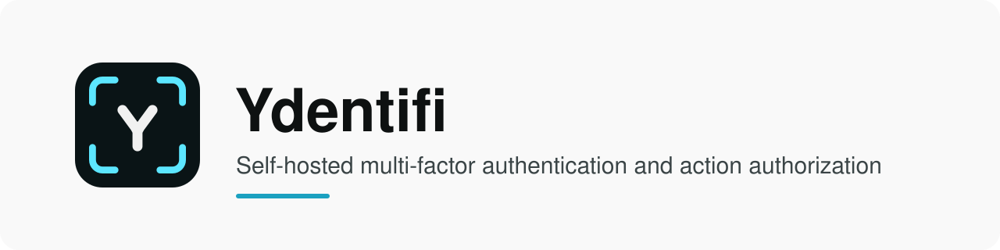
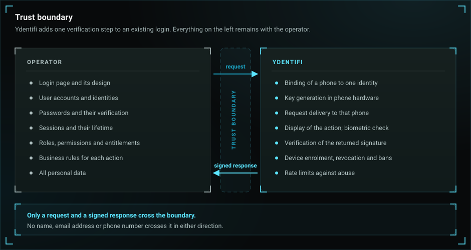
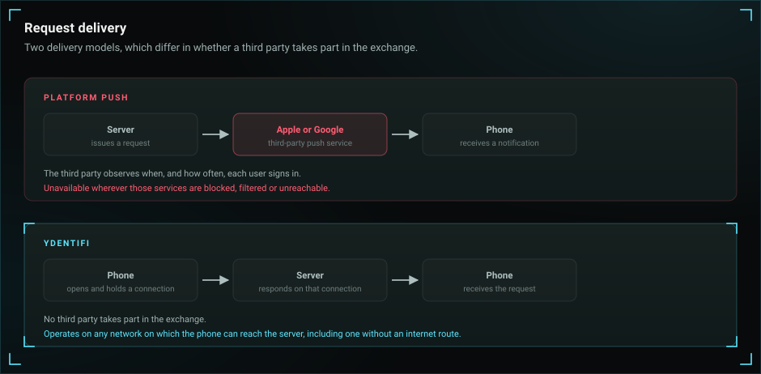
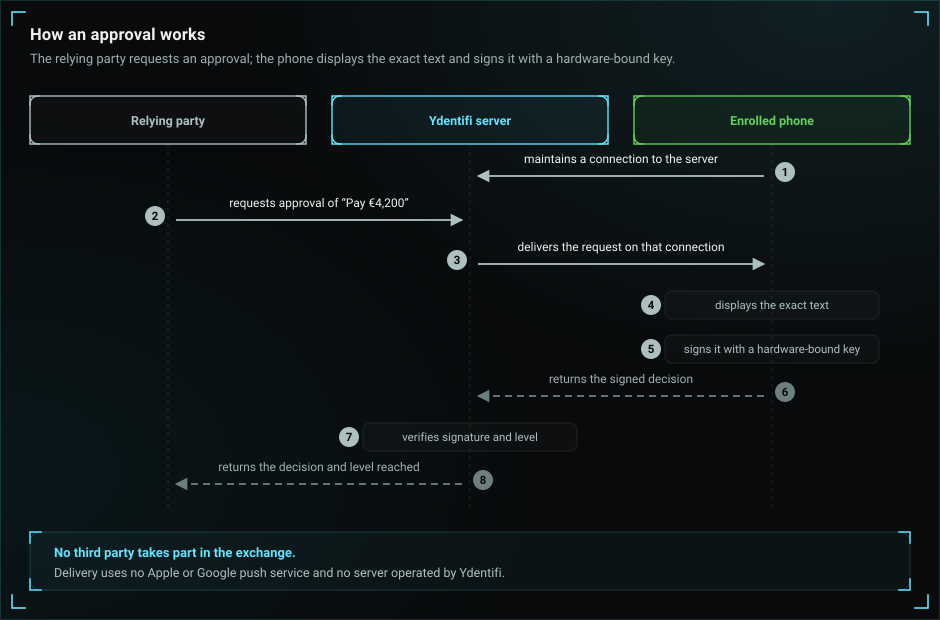

<p align="center">
  <picture>
    <source media="(prefers-color-scheme: dark)" srcset="assets/banner-dark.svg">
    
  </picture>
</p>

<p align="center">
  <a href="https://ydentifi.io/"><b>Website</b></a> ·
  <a href="https://ydentifi.io/docs/quickstart"><b>Quickstart</b></a> ·
  <a href="https://ydentifi.io/docs"><b>Documentation</b></a> ·
  <a href="https://ydentifi.io/docs/api"><b>API reference</b></a> ·
  <a href="https://ydentifi.io/product"><b>Product</b></a> ·
  <a href="https://ydentifi.io/pricing"><b>Pricing</b></a>
</p>

<p align="center">
  
  
  
  
</p>

> **General availability: 01/01/2027.** The SDKs, the mobile applications and licenses are available from
> that date. A live demonstration of the full ceremony is available at [ydentifi.io/demo](https://ydentifi.io/demo/).

**Ydentifi is self-hosted multi-factor authentication and action authorization.** Need multi-factor authentication, or cryptographic proof of **who approved what**, without giving up data sovereignty or starting a multi-month project? Add it **in a day** and keep **100% control**, on your own terms.

**At a glance:** 18 relying-party RPCs, each documented · 10 SDKs · No personal data · No outbound calls · gRPC-only · End-to-end mTLS · Post-quantum · Hardware-bound

## Contents

- [Deployment and data](#deployment-and-data)
- [Components](#components)
- [How it works](#how-it-works)
- [Comparison with the common MFA model](#comparison-with-the-common-mfa-model)
- [Design principles](#design-principles)
- [Security](#security)
  - [Shared responsibility](#shared-responsibility)
  - [Threat model](#threat-model)
  - [Cryptography](#cryptography)
- [Verification levels](#verification-levels)
  - [Actions that can require approval](#actions-that-can-require-approval)
- [Code example](#code-example)
- [Integration](#integration)
- [Getting started](#getting-started)
- [SDKs](#sdks)
- [Independent verification](#independent-verification)
- [Further reading](#further-reading)
- [Reporting a vulnerability](#reporting-a-vulnerability)

## Deployment and data

- **Deploys anywhere.** Run it as a container and a database in any cloud, on-prem, or fully air-gapped.
- **Uses or stores no personal data.** End users are opaque tokens — no name, email, or number.
- **[Independent of Apple & Google push](https://ydentifi.io/docs/background/mfa-without-platform-push).** Challenges stream straight from your server to the enrolled device.
- **Embedded, not an identity provider.** No OIDC, SAML, or SSO.

<p align="center">
  
</p>

<p align="center">
  
</p>

## Components

- **A server image.** A Docker container and a PostgreSQL database — that is the whole deployment. Run it on a single host, or put an L4 load balancer in front only when you want high availability.
- **A CLI.** One command-line tool — pull and run, like the server — to provision, deploy, operate, and simulate the entire system. The CLI is the product surface.
- **SDKs in 8 languages.** Go, Python, TypeScript, Java, .NET, Rust, Ruby and PHP, published at launch — or call the **gRPC API** directly. Plus native **Swift** and **Kotlin** SDKs to build the ceremony into your own app.
- **The authenticator app.** The one Ydentifi authenticator your users install — on the App Store and Google Play at launch, and no per-customer app to build or ship. It stays a blank shell until a user links it to your deployment by QR.

## How it works

Every authentication and every approval follows the same shape. No personal data changes hands, and nothing leaves your infrastructure.

<p align="center">
  
</p>

- **01 · Enroll: Bind the device.** Once per device, a single-use invite ties the user’s device to their opaque identity.
- **02 · Challenge: Ask for proof.** When a user starts a sensitive action, your server asks Ydentifi for a challenge carrying the exact on-screen details of that action.
- **03 · Sign: Approve on device.** The enrolled device shows those details and signs them with keys that never leave the phone.
- **04 · Verify: Check the signature.** Ydentifi checks the signature against the key the device enrolled with and streams your server the outcome.

Details: [The ceremony](https://ydentifi.io/docs/ceremony).

## Comparison with the common MFA model

| | Ydentifi | The industry default |
|---|---|---|
| **Your users’ data** | Never stored — opaque tokens; you stay the controller. | User records and persistent push tokens kept in the vendor’s cloud. |
| **Where it runs** | Your own infrastructure — any cloud, on-prem, or fully air-gapped. | The vendor’s SaaS; you depend on their uptime and region. |
| **Phones home to the vendor** | Never — no renewal call, no heartbeat, no telemetry. | A license check-in or telemetry enabled by default. |
| **Metadata to Apple / Google** | None — no platform push anywhere in the auth path. | Every authentication event passes through platform push, exposing its metadata. |
| **What you authenticate** | Any action — a signed yes or no over the exact request. | Usually the login only. |
| **Phishing resistance** | Signed over the exact on-screen details. | OTP or tap-to-approve — relay- and fatigue-attackable. |
| **Device capability** | Every response carries the level the device reached, so your server can tell a secure-element biometric from a passcode. | A pass is a pass — no signal of whether the biometric was hardware-grade or a look-alike. |
| **Keys & cryptography** | Non-exportable, bound to the device, post-quantum hybrid. | Shared secrets or server-side keys; classical crypto. |
| **Lock-in** | Self-hosted, gRPC, open SDKs — your keys, your exit. | Proprietary cloud; migrating out is costly. |

A generalization across the common push- and OTP-based MFA model — no specific vendor implied. Details: [the comparison on the product page](https://ydentifi.io/product#compare).

## Design principles

- **Independent implementation.** Ydentifi is an independent implementation, not a wrapper around the identity platforms of large vendors.
- **Unopinionated.** Roles and session models differ between organizations, so Ydentifi does not prescribe them.
- **Fail-closed.** Security and integrity take precedence over availability.
- **Transparent.** The internals are documented, including the exact algorithms and the deployment topology.

## Security

- **Hardware-bound keys.** Every approval is signed with a classical and a post-quantum key, both generated on the phone and never exported. On iPhone, both keys are held in the Secure Enclave. On Android, the classical key is held in the hardware-backed keystore. The post-quantum key is held there as well where the device supports ML-DSA (Android 17 and later), and otherwise in software, encrypted under a key in the hardware-backed keystore. Neither key can be restored onto another device.
- **[Phishing-resistant approvals](https://ydentifi.io/docs/background/transaction-signing).** The phone signs the exact details it shows. A spoofed or relayed request cannot change the amount, the payee or the action without the signature failing, and a used approval cannot be replayed.
- **[Post-quantum-ready cryptography](https://ydentifi.io/docs/background/post-quantum-mfa).** Approvals pair ES256 (ECDSA P-256) with ML-DSA-65 — the scheme NIST standardized as FIPS 204 — licenses pair Ed25519 with ML-DSA-65, and TLS uses a hybrid key exchange, designed to resist attack by future quantum computers, in line with EU guidance on post-quantum migration.
- **Hardware attestation.** The phone proves it is a genuine device running the genuine app, through the platform's own attestation. Every approval also carries the level of check the phone performed — device unlock or biometric — signed into the response. The deployment refuses any approval below the level you asked for.

### Shared responsibility

**Ydentifi secures — the software & protocol**

- **The cryptography and the wire.** Mutual-TLS transport, TLS 1.3 with post-quantum-hybrid key exchange, and signed authentication ceremonies.
- **The server’s correctness.** Tenant isolation, input validation, anti-abuse and rate-limiting, and fail-closed behaviour, verified by adversarial testing.
- **No invented primitives.** Every factor rests on a platform or standard mechanism — the device’s own biometric check in its secure element, RFC 6238 codes, ECDSA-P256 and ML-DSA-65 signatures, the platform’s location services.
- **Data minimization by design.** Ydentifi stores no end-user personal data — only opaque identifiers.

**You secure — the infrastructure you operate**

- **Your certificate authority and its keys.** You issue, store, and rotate the keys that root trust in your deployment.
- **The host, network, and database** the software runs on.
- **Your relying-party integration** and the credentials you issue to it.
- **Access to the operator surface** — who in your organization can administer the deployment.
- **Assurance of your own deployment.** Because the operator controls the topology and integration, we encourage a thorough penetration test of the deployment in its entirety.

### Threat model

| Threat | Mechanism |
|---|---|
| **Phishing & real-time relay** | The device signs over the **exact on-screen details**. A relayed or altered request — a changed amount or destination — breaks the signature. |
| **Stolen or leaked device backup** | Signing keys are **hardware-bound and non-exportable**. There is no key in a device backup for malware to copy. |
| **Credential reuse & breaches elsewhere** | The phishing-resistant factors carry **no shared secret on the wire, and no PII is stored**. A breach of some other service tells an attacker nothing. |
| **Personal-data breach** | Ydentifi holds **no end-user personal data** — there is no store of personal data to steal, and no jurisdictional obligation arising from one. |
| **A weak or tampered device** | **Platform attestation** proves each phone is genuine, and every approval names the level of check the phone performed. The server owns the policy, so an approval below the level you asked for is refused. |
| **Push-vendor throttling & surveillance** | Challenges stream directly to the device with **no Apple or Google push** in the path to throttle or observe. |
| **Future quantum computers** | Signatures and key exchange are **hybrid post-quantum**: approvals pair ES256 (ECDSA P-256) with ML-DSA-65, licenses pair Ed25519 with ML-DSA-65, and TLS uses a hybrid ML-KEM key exchange. |
| **A lost device** | Re-enroll on a new device; the lost device’s key is **revoked** and can no longer sign. Its TOTP codes stay valid until you replace the secret, after the recovery and not before it. |
| **Vendor lock-in** | Self-hosted, gRPC-only, with open client SDKs. Keys, data and infrastructure remain under your control and are **portable**. |

### Cryptography

- **Hybrid post-quantum.** The mTLS transport uses a post-quantum-hybrid key exchange, licenses are hybrid-signed (Ed25519 paired with **ML-DSA-65**), and every approval carries a hybrid **ES256 + ML-DSA-65** signature.
- **Hardware-bound keys.** Signing keys are generated in the device’s secure element and are non-exportable.
- **Signed ceremonies.** Every approval is a hybrid **ES256 + ML-DSA-65** signature over a [canonical payload](https://ydentifi.io/docs/glossary#canonical-payload) that binds the exact action.
- **History in a log stream you keep.** Device-lifecycle events — enrollment, replacement, revocation, ban — and what the server did are both emitted as structured lines to your own log pipeline, so their retention and access are whatever that pipeline already does.

The [Security model](https://ydentifi.io/docs/security-model) sets out what Ydentifi defends against and what it does not.

## Verification levels

A signed response carries one of **2 levels**: the user unlocked the device, or the user passed a biometric check with no passcode fallback. **Location**, **number matching** and **codes** are separate dimensions, chosen independently — not stronger levels. You request what an action needs **per call**; the server enforces it, and a device that cannot meet it is denied rather than silently downgraded.

- **Level 1:** Device unlock
- **Level 2:** Biometric only
- **Separate:** Location · number matching · codes

Details: [Factors & levels](https://ydentifi.io/docs/factors).

### Actions that can require approval

- Money transfers
- Purchases & orders
- Access to media & content
- Subscriptions
- Locking & unlocking physical & digital assets
- Launching deployments or critical engineering processes
- Any other action that requires explicit approval

## Code example

Taken from the Go SDK's examples, which read the client's configuration from the `YDFI_*` environment;
every method is documented in the [API reference](https://ydentifi.io/docs/api).

```go
client, err := ydentifi.New()
if err != nil {
	log.Fatal(err)
}
defer client.Close()

ctx, cancel := context.WithTimeout(context.Background(), 10*time.Second)
defer cancel()

const opaqueID = "8b2c4f1e9d7a6b5c3e2f1a0b9c8d7e6f5a4b3c2d1e0f9a8b7c6d5e4f3a2b1c0d"

ch, err := client.IssueAuthChallenge(ctx, ydentifi.IssueAuthChallengeRequest{
	OpaqueID:    opaqueID,
	Context:     []byte("Transfer of 1,000 EUR to ACME Corp"),
	MinStrength: ydentifi.AuthStrengthBiometric,
})
if err != nil {
	log.Fatal(err)
}

// The server ends the wait about 5 seconds after the challenge
// expires; a deadline bounds it as well.
wait, stop := context.WithTimeout(context.Background(), 90*time.Second)
defer stop()

for frame, err := range client.AwaitChallenge(wait, ch.ChallengeID) {
	if err != nil {
		log.Fatal(err)
	}
	if !frame.Status.IsTerminal() {
		continue // Pending or Delivered
	}
	switch frame.Status {
	case ydentifi.ChallengeStatusApproved:
		fmt.Println("approved")
	case ydentifi.ChallengeStatusDenied:
		// DeclineReasonNotMe reports an attempt the user did not make.
		fmt.Println("denied:", frame.DeclineReason)
	case ydentifi.ChallengeStatusRejected:
		// The user approved and a check refused the approval; this is
		// not a decline.
		fmt.Println("rejected:", frame.VerificationFailure)
	default:
		fmt.Println("ended:", frame.Status)
	}
}
```

<details>
<summary><b>The same example in Python</b></summary>

Taken from the Python SDK's examples. `make_client` stands for the client configuration, and `args` for the
example's command-line arguments.

```python
(opaque_id,) = args("opaque_id")
with make_client() as client:
    challenge = client.issue_auth_challenge(
        ydentifi.IssueAuthChallengeRequest(
            opaque_id=opaque_id,
            context=b"Authorize wire transfer of EUR 1,000",
            min_strength=ydentifi.AuthStrength.BIOMETRIC,
        ),
    )
    # The timeout leaves time for the user to answer.
    with contextlib.closing(
        client.await_challenge(challenge.challenge_id, timeout=90)
    ) as frames:
        result = next(f for f in frames if f.status in _ENDED)
    if result.status == ydentifi.ChallengeStatus.APPROVED:
        print("approved - proceed with the transfer")
    elif result.status == ydentifi.ChallengeStatus.DENIED:
        # The user declined. NOT_ME reports an attempt the user did not initiate.
        print(f"the user declined - reason: {result.decline_reason.name}")
    elif result.status == ydentifi.ChallengeStatus.REJECTED:
        # User approval failed verification and must not be recorded as a decline.
        # WRONG_MATCH_CODE may indicate a request from another session.
        print(f"a check refused it: {result.verification_failure.name}")
    elif result.status == ydentifi.ChallengeStatus.EXPIRED:
        print("challenge expired - issue a new one")
    elif result.status == ydentifi.ChallengeStatus.DISMISSED:
        print("the user dismissed it without answering - ask again")
    else:
        print(f"unexpected status: {result.status.name}")
```

</details>

## Integration

- **Partial: A step-up where it matters.** Add a single ceremony before the highest-risk actions — a signed approval before a transfer, a deployment, an unlock — and leave the rest of the login unchanged.
- **Full: Your whole second factor.** Make Ydentifi the second factor across your product, from enrollment through every sensitive action, with the level chosen per action by your own policy.

## Getting started

- **Running on your laptop in 5 minutes.** One command brings up the server and its database.
- **Deployed in a day.** Container and database — an L4 load balancer only if you want high availability.

1. Run the server and its database locally: [Quickstart](https://ydentifi.io/docs/quickstart).
2. Add the SDK for the relevant language: [SDKs](https://ydentifi.io/docs/sdks).
3. Deploy on the operator's infrastructure: [Deploy](https://ydentifi.io/docs/deploy).

## SDKs

**Your server talks to the deployment.** An idiomatic library over the relying-party gRPC surface — create users, issue challenges, verify approvals, manage devices. This is what your application backend calls.

- **Go** · github.com/ydentifi/go · [source](https://github.com/ydentifi/go)
- **Python** · ydentifi · PyPI · [source](https://github.com/ydentifi/python)
- **TypeScript** · @ydentifi/client · npm · at launch
- **Java** · com.ydentifi:client · Maven Central · at launch
- **.NET** · Ydentifi.Client · NuGet · at launch
- **Rust** · ydentifi · crates.io · at launch
- **Ruby** · ydentifi · RubyGems · at launch
- **PHP** · ydentifi/client · Packagist · at launch

**The authenticator inside your app.** Embed enrollment, hardware-backed signing, and the approval UI directly in your own iOS or Android app, instead of sending users to the standalone Ydentifi app.

- **iOS — Swift** · Swift Package Manager · [guide](https://ydentifi.io/docs/swift) · at launch
- **Android — Kotlin** · Maven Central · [guide](https://ydentifi.io/docs/kotlin) · at launch

The SDKs are open source under the Apache License 2.0. The server is licensed software; see [Pricing](https://ydentifi.io/pricing).

## Independent verification

Available without login, sales call or NDA.

- **[The complete API](https://ydentifi.io/docs/api).** All 18 relying-party RPCs, with their request and response fields and the typed errors each one raises — not a summary, the surface your backend actually calls.
- **[The exact limits](https://ydentifi.io/docs/limits).** The plan caps set by the license, and the per-user rate limits in each of the 3 tiers, with their numbers.
- **[What works and what breaks](https://ydentifi.io/docs/deploy).** A load-balancer matrix that names specific products — which ones pass the mutual-TLS handshake through, and which ones silently break it.
- **[A running deployment](https://ydentifi.io/docs/quickstart).** One container and a database, up on your laptop with a working ceremony in an afternoon — before any conversation.
- **[The signing code](https://ydentifi.io/docs/sdks).** The device SDK — the part that holds the keys, builds the signed response, and talks to your server — is open source under Apache 2.0, published at launch.
- **[The price](https://ydentifi.io/pricing).** A flat number, published, with a slider.

The server’s **key design and operational principles** stay closed. The methods used to establish its correctness:

- **A machine-checked security specification.** The security-critical properties of the system are written as a formal specification and verified mechanically — the check runs in the build, and it either passes or it fails.
- **Adversarial, multi-model review.** The system is red-teamed by several independent models in fresh-context rounds, run to convergence — until what is left is only false positives.
- **Mechanical cross-language parity.** One shared scenario suite runs against every SDK; if any language returns a different verdict for the same scenario, the divergence blocks the merge.
- **Fail-closed by default.** When something is ambiguous or unavailable, the system refuses rather than guesses.

Details: [Verify](https://ydentifi.io/verify).

## Further reading

- [What is Ydentifi](https://ydentifi.io/docs/what-is-ydentifi) and the [Product](https://ydentifi.io/product) overview
- [Comparison with push- and code-based MFA](https://ydentifi.io/product#compare)
- [Architecture & topology](https://ydentifi.io/docs/architecture), [The ceremony](https://ydentifi.io/docs/ceremony) and [Factors & levels](https://ydentifi.io/docs/factors)
- [Security model](https://ydentifi.io/docs/security-model)
- [MFA without platform push](https://ydentifi.io/docs/background/mfa-without-platform-push)
- [Post-quantum MFA](https://ydentifi.io/docs/background/post-quantum-mfa)
- [Transaction signing](https://ydentifi.io/docs/background/transaction-signing)
- [On passkeys](https://ydentifi.io/docs/background/on-passkeys), [On passwords](https://ydentifi.io/docs/background/on-passwords) and [On devices](https://ydentifi.io/docs/background/on-devices)
- [Integrate: step-up](https://ydentifi.io/docs/integrate/step-up), [Integrate: full](https://ydentifi.io/docs/integrate/full) and [Authorize an action](https://ydentifi.io/docs/authorize)

## Reporting a vulnerability

Report vulnerabilities to [security@ydentifi.io](mailto:security@ydentifi.io). The
[Security & Vulnerability Disclosure](https://ydentifi.io/legal/security) policy includes a safe harbour for researchers.

<p align="center"><sub>Built and operated in the EU by Ydentifi Ltd.</sub></p>
