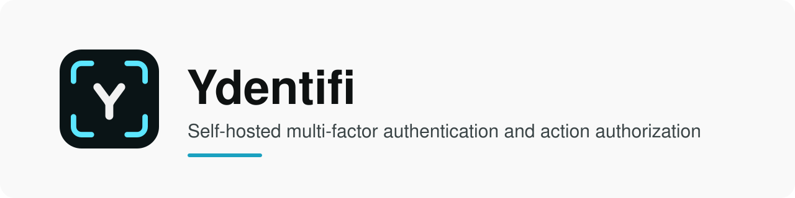
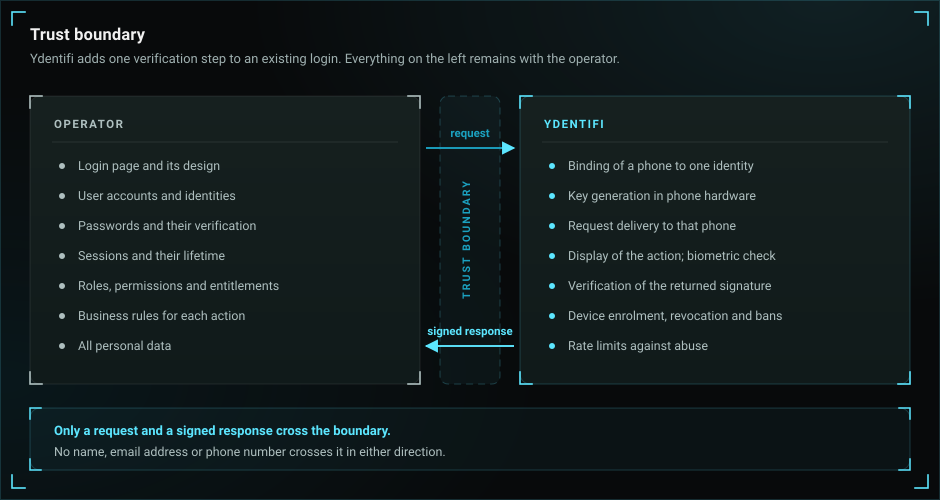
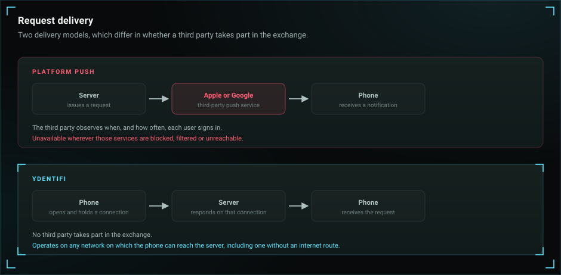
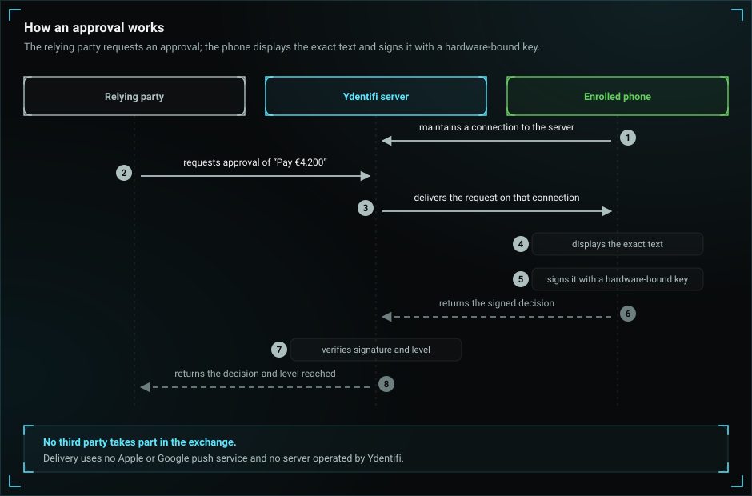

<p align="center">
  <picture>
    <source media="(prefers-color-scheme: dark)" srcset="assets/banner-dark.svg">
    
  </picture>
</p>

<p align="center">
  <a href="https://ydentifi.io/"><b>Website</b></a> ·
  <a href="https://ydentifi.io/docs/quickstart"><b>Quickstart</b></a> ·
  <a href="https://ydentifi.io/docs"><b>Documentation</b></a> ·
  <a href="https://ydentifi.io/docs/api"><b>API reference</b></a> ·
  <a href="https://ydentifi.io/product"><b>Product</b></a> ·
  <a href="https://ydentifi.io/pricing"><b>Pricing</b></a>
</p>

<p align="center">
  
  
  
  
</p>

> **General availability: 01/01/2027.** The SDKs, the mobile applications and licenses are available from
> that date. A live demonstration of the full ceremony is available at [ydentifi.io/demo](https://ydentifi.io/demo/).

**Ydentifi is self-hosted multi-factor authentication and action authorization.** Need multi-factor authentication, or cryptographic proof of **who approved what**, without giving up data sovereignty or starting a multi-month project? Add it **in a day** and keep **100% control**, on your own terms.

## Deployment and data

- **Deploys anywhere.** Run it as a container and a database in any cloud, on-prem, or fully air-gapped.
- **Uses or stores no personal data.** End users are opaque tokens — no name, email, or number.
- **[Independent of Apple & Google push](https://ydentifi.io/docs/background/mfa-without-platform-push).** Challenges stream straight from your server to the enrolled device.
- **Embedded, not an identity provider.** No OIDC, SAML, or SSO.

<p align="center">
  
</p>

<p align="center">
  
</p>

## How it works

Every authentication and every approval follows the same shape. No personal data changes hands, and nothing leaves your infrastructure.

<p align="center">
  
</p>

- **01 · Enroll: Bind the device.** Once per device, a single-use invite ties the user’s device to their opaque identity.
- **02 · Challenge: Ask for proof.** When a user starts a sensitive action, your server asks Ydentifi for a challenge carrying the exact on-screen details of that action.
- **03 · Sign: Approve on device.** The enrolled device shows those details and signs them with keys that never leave the phone.
- **04 · Verify: Check the signature.** Ydentifi checks the signature against the key the device enrolled with and streams your server the outcome.

Details: [The ceremony](https://ydentifi.io/docs/ceremony).

## Security

- **Hardware-bound keys.** Every approval is signed with a classical and a post-quantum key, both generated on the phone and never exported. On iPhone, both keys are held in the Secure Enclave. On Android, the classical key is held in the hardware-backed keystore. The post-quantum key is held there as well where the device supports ML-DSA (Android 17 and later), and otherwise in software, encrypted under a key in the hardware-backed keystore. Neither key can be restored onto another device.
- **[Phishing-resistant approvals](https://ydentifi.io/docs/background/transaction-signing).** The phone signs the exact details it shows. A spoofed or relayed request cannot change the amount, the payee or the action without the signature failing, and a used approval cannot be replayed.
- **[Post-quantum-ready cryptography](https://ydentifi.io/docs/background/post-quantum-mfa).** Signatures pair Ed25519/P-256 with ML-DSA-65 — the scheme NIST standardized as FIPS 204 — and TLS uses a hybrid key exchange, designed to resist attack by future quantum computers, in line with EU guidance on post-quantum migration.
- **Hardware attestation.** The phone proves it is a genuine device running the genuine app, through the platform's own attestation. Every approval also carries the level of check the phone performed — device unlock or biometric — signed into the response. The deployment refuses any approval below the level you asked for.

The [Security model](https://ydentifi.io/docs/security-model) sets out what Ydentifi defends against and what it does not.

## Verification levels

A signed response carries one of **2 levels**: the user unlocked the device, or the user passed a biometric check with no passcode fallback. **Location**, **number matching** and **codes** are separate dimensions, chosen independently — not stronger levels. You request what an action needs **per call**; the server enforces it, and a device that cannot meet it is denied rather than silently downgraded.

- **Level 1:** Device unlock
- **Level 2:** Biometric only
- **Separate:** Location · number matching · codes

Details: [Factors & levels](https://ydentifi.io/docs/factors).

### Actions that can require approval

- Money transfers
- Purchases & orders
- Access to media & content
- Subscriptions
- Locking & unlocking physical & digital assets
- Launching deployments or critical engineering processes
- Any other action that requires explicit approval

## Code example

Taken from the Go SDK's examples. `newExampleClient` stands for the client configuration; every method is
documented in the [API reference](https://ydentifi.io/docs/api).

```go
client := newExampleClient()
defer client.Close()

const opaqueID = "a3f1...0b9e"

ch, err := client.IssueAuthChallenge(context.Background(), ydentifi.IssueAuthChallengeRequest{
	OpaqueID:    opaqueID,
	Context:     []byte("Authorize wire transfer of €1,000"),
	MinStrength: ydentifi.AuthStrengthBiometric,
})
if err != nil {
	log.Fatal(err)
}

ctx, cancel := context.WithTimeout(context.Background(), 90*time.Second)
defer cancel()

result, err := client.AwaitChallenge(ctx, ch.ChallengeID)
if err != nil {
	log.Fatal(err)
}

switch result.Status {
case ydentifi.ChallengeStatusApproved:
	fmt.Println("approved — proceed with the transfer")
case ydentifi.ChallengeStatusDenied:
	fmt.Println("denied — reason:", result.DeclineReason)
case ydentifi.ChallengeStatusExpired:
	fmt.Println("challenge expired — issue a new one")
default:
	fmt.Println("unexpected status:", result.Status)
}
```

<details>
<summary><b>The same example in Python</b></summary>

Taken from the Python SDK's examples. `make_client` stands for the client configuration.

```python
opaque_id = "a3f1...0b9e"
with make_client() as client:
    challenge = client.issue_auth_challenge(
        ydentifi.IssueAuthChallengeRequest(
            opaque_id=opaque_id,
            context=b"Authorize wire transfer of EUR 1,000",
            min_strength=ydentifi.AuthStrength.BIOMETRIC,
        ),
    )
    result = client.await_challenge(challenge.challenge_id)
    if result.status == ydentifi.ChallengeStatus.APPROVED:
        print("approved - proceed with the transfer")
    elif result.status == ydentifi.ChallengeStatus.DENIED:
        # The user refused. Their own reason, worth recording as
        # such: NOT_ME is somebody reporting an attempt they did
        # not make.
        print(f"the user declined - reason: {result.decline_reason.name}")
    elif result.status == ydentifi.ChallengeStatus.REJECTED:
        # The user AGREED and a check refused it. Do not record
        # this as the user declining — they did not.
        #
        # WRONG_MATCH_CODE is the one to act on: a user approving
        # a number that was not on their screen is what an approval
        # driven from somebody else's session looks like.
        print(f"a check refused it: {result.verification_failure.name}")
    elif result.status == ydentifi.ChallengeStatus.EXPIRED:
        print("challenge expired - issue a new one")
    else:
        print(f"unexpected status: {result.status.name}")
```

</details>

## Integration

- **Partial: A step-up where it matters.** Add a single ceremony before the highest-risk actions — a signed approval before a transfer, a deployment, an unlock — and leave the rest of the login unchanged.
- **Full: Your whole second factor.** Make Ydentifi the second factor across your product, from enrollment through every sensitive action, with the tier chosen per action by your own policy.

## Getting started

- **Running on your laptop in 5 minutes.** One command brings up the server and its database.
- **Deployed in a day.** Container and database — an L4 load balancer only if you want high availability.

1. Run the server and its database locally: [Quickstart](https://ydentifi.io/docs/quickstart).
2. Add the SDK for the relevant language: [SDKs](https://ydentifi.io/docs/sdks).
3. Deploy on the operator's infrastructure: [Deploy](https://ydentifi.io/docs/deploy).

## SDKs

**Your server talks to the deployment.** An idiomatic library over the relying-party gRPC surface — create users, issue challenges, verify approvals, manage devices. This is what your application backend calls.

- **Go** · github.com/ydentifi/go · at launch
- **Python** · ydentifi · PyPI · at launch
- **TypeScript** · @ydentifi/client · npm · at launch
- **Java** · com.ydentifi:client · Maven Central · at launch
- **.NET** · Ydentifi.Client · NuGet · at launch
- **Rust** · ydentifi · crates.io · at launch
- **Ruby** · ydentifi · RubyGems · at launch
- **PHP** · ydentifi/client · Packagist · at launch

**The authenticator inside your app.** Embed enrollment, hardware-backed signing, and the approval UI directly in your own iOS or Android app, instead of sending users to the standalone Ydentifi app.

- **iOS — Swift** · Swift Package Manager · [guide](https://ydentifi.io/docs/swift) · at launch
- **Android — Kotlin** · Maven Central · [guide](https://ydentifi.io/docs/kotlin) · at launch

The SDKs are open source under the Apache License 2.0. The server is licensed software; see [Pricing](https://ydentifi.io/pricing).

## Further reading

- [What is Ydentifi](https://ydentifi.io/docs/what-is-ydentifi) and the [Product](https://ydentifi.io/product) overview
- [Comparison with push- and code-based MFA](https://ydentifi.io/product#compare)
- [Architecture & topology](https://ydentifi.io/docs/architecture), [The ceremony](https://ydentifi.io/docs/ceremony) and [Factors & levels](https://ydentifi.io/docs/factors)
- [Security model](https://ydentifi.io/docs/security-model)
- [MFA without platform push](https://ydentifi.io/docs/background/mfa-without-platform-push)
- [Post-quantum MFA](https://ydentifi.io/docs/background/post-quantum-mfa)
- [Transaction signing](https://ydentifi.io/docs/background/transaction-signing)
- [On passkeys](https://ydentifi.io/docs/background/on-passkeys), [On passwords](https://ydentifi.io/docs/background/on-passwords) and [On devices](https://ydentifi.io/docs/background/on-devices)
- [Integrate: step-up](https://ydentifi.io/docs/integrate/step-up), [Integrate: full](https://ydentifi.io/docs/integrate/full) and [Authorize an action](https://ydentifi.io/docs/authorize)

## Reporting a vulnerability

Report vulnerabilities to [security@ydentifi.io](mailto:security@ydentifi.io). The
[Security & Vulnerability Disclosure](https://ydentifi.io/legal/security) policy includes a safe harbour for researchers.

<p align="center"><sub>Built and operated in the EU by Ydentifi Ltd.</sub></p>
